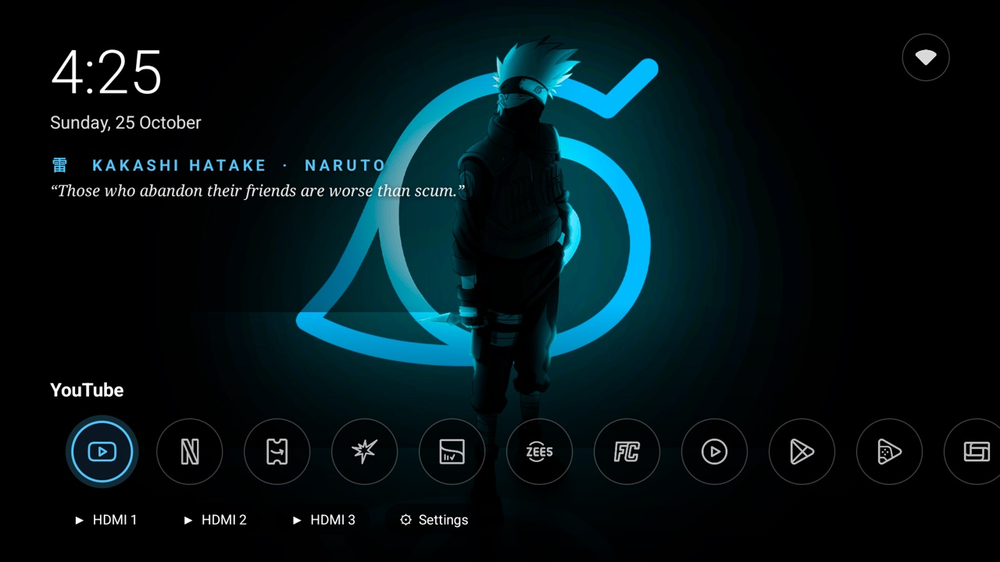
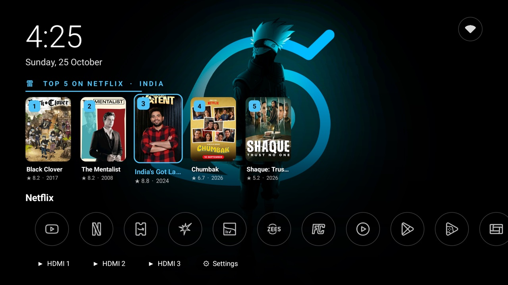

# Anime Home

A lightweight, Kakashi-themed home screen (launcher) for Android TV, built for a Xiaomi Mi TV
(Android 14, 2 GB RAM). It's plain Java with no libraries, and uses about 40 MB of RAM.





## Features

- **Kakashi Hatake theme**: wallpaper that changes daily, a clock and date, a quote of the day, and Kakashi-blue accents.
- **Icon app row**: round glass buttons with line-art app icons
  ([Lawnicons](https://github.com/LawnchairLauncher/lawnicons)). The selected app glows blue.
  Streaming apps come first. Hold **OK** on an app to move or hide it.
- **Top 5 shelf**: hover over a streaming app (Netflix, Prime Video, JioHotstar, SonyLIV, Zee5,
  MX Player) to see the five most popular titles in India on that service, with posters, IMDb scores and years.
  Press **Up** to browse them and **OK** to open the title directly in its app (deep link).
  Data comes from JustWatch's public API and is cached for 6 hours, so the shelf appears instantly.
- **HDMI 1–3 and Settings** buttons, plus a **Wi-Fi status button** (top right) that shows signal strength.

> Your personal "Continue watching" history can't be shown. Android only lets privileged system
> launchers read it (`ACCESS_ALL_EPG_DATA`), so the shelf shows what's popular instead.

## Install

### Easiest: let an AI assistant do it

Open an AI coding assistant that can run commands on your computer, such as [Claude Code](https://claude.com/claude-code),
Codex CLI or Gemini CLI. Then paste this prompt:

```text
Install the "Anime Home" launcher on my Android TV.
Project: https://github.com/VishalGujela/anime-tv-home

Please:
1. Check that adb (Android platform-tools) is installed on this computer, and install it if it isn't
   (macOS: brew install --cask android-platform-tools, Debian/Ubuntu: sudo apt install adb, Windows: winget install Google.PlatformTools).
2. Ask me for my TV's IP address. If I haven't enabled debugging yet, walk me through it on the TV:
   Settings > Device Preferences > About > press "Build" 7 times to unlock Developer options,
   then Settings > Device Preferences > Developer options > turn on USB debugging and Network debugging.
   The IP is under Settings > Network & Internet > (your Wi-Fi network).
3. Explain that the installer will install the app and make it my default home screen, and wait for my OK.
4. On macOS or Linux, run:
     curl -fsSL https://raw.githubusercontent.com/VishalGujela/anime-tv-home/main/install.sh | bash -s -- <TV_IP>
   On Windows, do the same steps with adb directly: adb connect <TV_IP>:5555, download
   https://github.com/VishalGujela/anime-tv-home/releases/latest/download/anime-home.apk,
   adb install -r anime-home.apk, then
   adb shell cmd package set-home-activity com.vishal.animehome/.Home
5. If the TV shows "Allow debugging?", tell me to choose "Always allow" and press OK, then continue.
6. When it's done, confirm Anime Home is on screen, tell me how to undo it, and remind me to turn
   network debugging off again.
```

### Quick install (macOS / Linux)

Turn on network debugging on the TV (see step 2 above), then run:

```sh
curl -fsSL https://raw.githubusercontent.com/VishalGujela/anime-tv-home/main/install.sh | bash -s -- <TV_IP>
```

The script connects to the TV, checks that it's an Android TV running Android 9 or newer, downloads the latest release,
installs it, makes it the default home screen, and prints how to undo. To remove it again:

```sh
curl -fsSL https://raw.githubusercontent.com/VishalGujela/anime-tv-home/main/install.sh | bash -s -- <TV_IP> --uninstall
```

### Manual install

Download `anime-home.apk` from [Releases](../../releases), then run:

```sh
adb connect <tv-ip>:5555
adb install -r anime-home.apk
adb shell cmd package set-home-activity com.vishal.animehome/.Home
```

Run the last command again after every reinstall, because reinstalling can reset the default home screen.
HDMI buttons need the TV's built-in input player. On Mi TVs that's **Mi Live TV** (`com.mitv.livetv`).

## Build from source

Requirements: JDK 17 and the Android SDK (`platforms;android-34`, `build-tools;34.0.0`). Gradle is not needed.

```sh
brew install openjdk@17 && brew install --cask android-commandlinetools
sdkmanager --sdk_root=$HOME/Library/Android/sdk "platforms;android-34" "build-tools;34.0.0"
./build.sh            # -> build/anime-home.apk
```

`build.sh` runs aapt2, javac, d8, zipalign and apksigner. On the first build it creates a signing key at
`~/.android/animehome.keystore`. Set `ANIME_HOME_KEYSTORE` / `ANIME_HOME_KS_PASS` to use your own key.

## Regression tests

`tools/regression.py` drives the TV over adb and checks about 60 behaviours: default home, screen density, every app's
shelf, focus zoom, shelf navigation, HDMI and deep-link resolution, crashes and memory. It confirms
Anime Home is in front before every key press.

```sh
python3 -I tools/regression.py                 # uses $ANIME_TV_DEVICE or the connected device
python3 -I tools/regression.py --reboot        # also checks everything survives a restart
```

## Project layout

| Path | What |
|---|---|
| `src/com/vishal/animehome/Home.java` | Home screen: layout, app row, buttons, shelf wiring |
| `src/com/vishal/animehome/Shelf.java` | Top 5 shelf UI and animations |
| `src/com/vishal/animehome/Suggestions.java` | JustWatch fetch, caching and poster loading |
| `src/com/vishal/animehome/Theme.java` | Theme definition (Kakashi) |
| `src/com/vishal/animehome/FxView.java` | Optional focus effects (unused by the Kakashi theme) |
| `tools/` | Icon renderers, icon maps, regression tests |
| `install.sh` | One-command installer / uninstaller |
| `docs/screenshots/` | README screenshots |

## Credits

See [NOTICE.md](NOTICE.md). App icons are from Lawnicons and status icons from Material Symbols, both Apache 2.0.
The wallpapers are fan art from wallhaven.cc and belong to their artists. App names and logos are
trademarks of their owners. Not affiliated with any streaming service.
